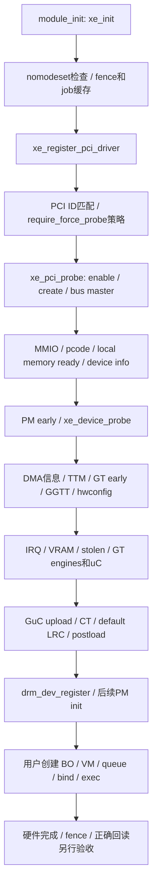

# xe 初始化、运行和回收

以下为固定 Linux 6.14 调用链，不是已实现的 Darwin 生命周期。关闭display后条件路径可跳过，但不能跳过core错误检查。[L01][L02]

## 原始入口与probe



1. `xe_init` 依次执行初始化表，任一步失败逆序执行已成功step的exit；注销PCI触发设备解绑。[L03]
2. `pci_driver.id_table` 决定匹配，DG2的force-probe检查在硬件初始化前；`pcim_enable_device`、`xe_device_create`、`pci_set_drvdata`、`pci_set_master` 后进入设备probe。[L04][L05][L07]
3. early阶段设置MMIO/平台信息并等local memory ready；`xe_device_probe`建立DMA信息、TTM、GT、GGTT，**最小GuC hwconfig加载发生在完整GT初始化之前**，不是只在末尾一次加载。[L51][L08][L53]
4. 安装IRQ、VRAM和GT后，GuC upload→通信→default LRC→postload；GSC load是异步且按平台能力分支；DG2的HuC/GSC表不含该平台。[L11][L13]
5. `drm_dev_register`后仍有sanitize action和PCI外层PM init；发布render设备不证明任何用户batch执行过。[L04][L08]

## 用户态执行路径

`xe_file_open`分配per-file对象、VM/queue xarray与锁；VM创建先构造完整对象，最后分配用户ID，防止提前发布引发UAF。[L09][L43]

```text
DRM_IOCTL_XE_GEM_CREATE → GEM/TTM backing
DRM_IOCTL_XE_VM_CREATE → per-file VM
DRM_IOCTL_XE_EXEC_QUEUE_CREATE → engine / LRC / scheduler
DRM_IOCTL_XE_VM_BIND → GPUVA / page tables / bind sync
DRM_IOCTL_XE_EXEC → queue引用 / sync解析 / VM和reservation锁
  → userptr必要时repin → 创建job与依赖 → arm（发布不可回退点）
  → push scheduler → guc_exec_queue_run_job
  → 注册context / emit_job / submit_exec_queue → GuC CT
  → GPU更新seqno + IRQ/irq_work → dma_fence观察与信号
  → 等待 / readback / 全量数据比较
```

来源：[L09][L19][L26][L27][L40][L42]。注意零batch EXEC可能仅传递同步，不能当GPU执行证据；fence也可能因错误被软件完成，必须联合硬件seqno、错误状态与回读检查。

## 回收不是简单把probe倒过来

| 场景 | Linux已读路径 | Darwin必须建立的条件 |
|---|---|---|
| module init失败 | init_funcs逆序exit [L03] | 初始管理器每一步事务化；注册失败必须传播，不能照搬忽略返回值的SYSINIT |
| probe中段失败 | device_probe显式goto清理display/OA/已成功GT；devm/drmm各自管理资源 [L08][L29] | 记录初始化阶段和两个资源owner，不重复释放；未来每stage故障注入 |
| EXEC在arm前失败 | unwind sync/job/VM locks/ref；EAGAIN按规则retry [L19] | 所有失败输出/ID不发布，bounded取消策略；不能破坏ww锁重试 |
| EXEC在arm后失败 | scheduler/backend负责已发布job清理 [L19][L40] | 错误fence+排空，不直接释放GPU可能仍访问的BO |
| 普通fd close/进程退出 | file_close PM get→kill/put queues→close/put VM→file_put→PM put [L09] | 停本连接准入、等ioctl不再修改ID表；mach clientDied只提供通知，不替GPU drain |
| queue destroy | GuC disable/deregister及cleanup消息；async fini取消TDR、entity/scheduler fini [L41] | scheduler自身不能等自身销毁；destroy worker持refs，卸载必须等全部完成 |
| PCI remove | xe_pci_remove→device_remove→OA unregister→display/unplug→OA/GSC fini→GT remove→PM runtime fini [L04][L10][L23] | 先拒绝新请求；旧file可仍存在；证明DMA/回调停止才撤销mapping |
| GT reset | stopped原子置位、准备/排空、pagefault/TLB reset、uC重新初始化、resubmit或wedged [L20][L24] | device在线才可MMIO；连接generation与旧VA/fence策略必须明确 |
| sleep/runtime suspend | VRAM mapping撤销/驱逐、GT suspend、IRQ suspend；失败有恢复路径 [L25][L46] | IOService PM ack仅在真正完成后；pm_get与suspend锁序防死锁 |
| hot removal | DRM unplug提供用户访问防护；同步/managed refs仍需完成 [L10][L29] | 不把普通有电remove/reset流程用于失联设备；具体 surprise-remove安全还未硬件证明 |

### 已识别锁序与寿命风险

- EXEC的VM锁、GPUVM/BO reservations、userptr notifier锁不是单一全局锁。[L17][L19][L31]
- GuC CT锁与submission_state锁存在依赖；reset_prepare用原子避免相反锁序。[L20]
- runtime PM get可能等待回调，若调用方已持回调需要的锁会死锁；上游有专门说明。[L46]
- fence最终free使用`call_rcu`，queue fini可能转destroy_wq；退出不能只等IRQ一次。[L22][L41]
- Linux postclose明确假设ioctl已不再变更queue表，新的Darwin transport必须主动满足，不能复制注释当保证。[L09]

未来Darwin**建议不变量（未实现）**：准入与在途计数同一临界区；跨阻塞准备保留generation/owner refs；callback锁外执行；停止路径不持有回调所需锁等待；所有waiter都能被close/reset/lost取消；只在硬件静默有证据后释放backing。具体锁序应在实施前由完整可达图确定，本报告不虚构全局锁序已经证明。
