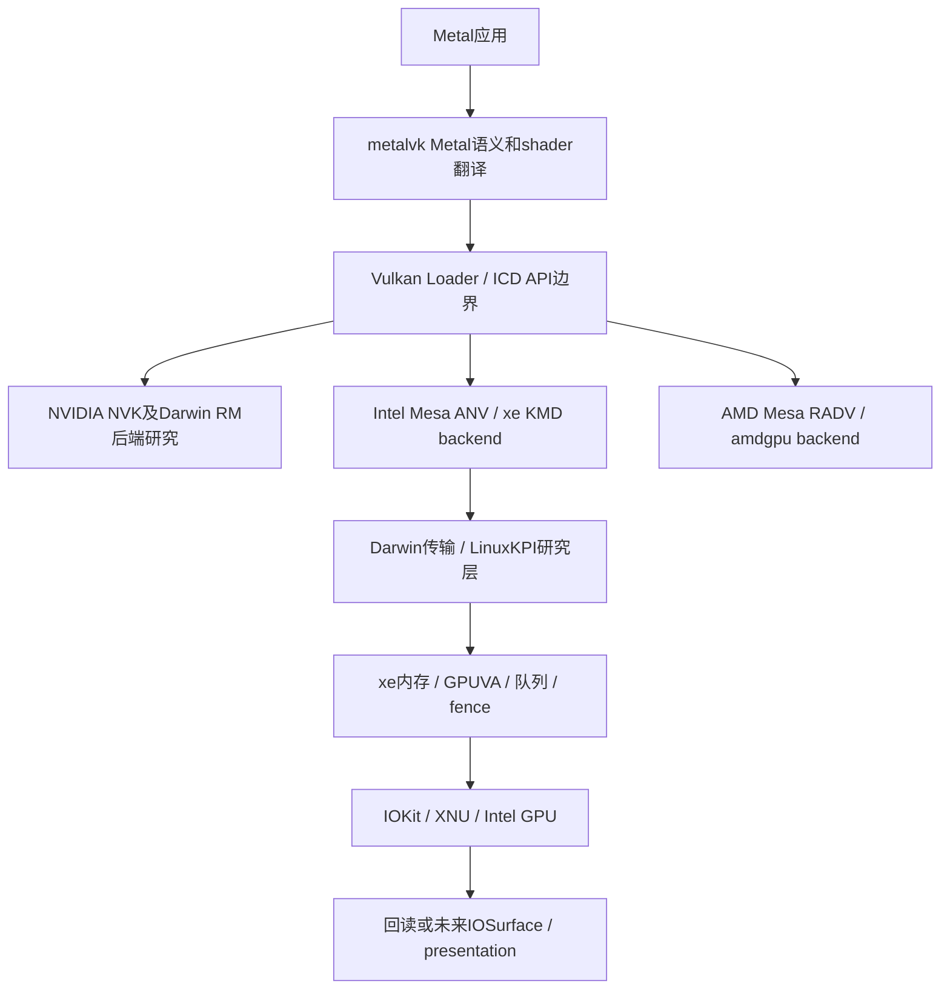

# Vulkan ICD、内核与Metal边界

现有NVIDIA私有transport v2/discovery只属于厂商后端；不得把它作为Intel DRM消息格式，也不恢复全局自造GPU ABI。LinuxKPI不能进入SDK-free `libmetalvk.a` 或common vendor-neutral headers。

## 正常Linux用户态与本轮核对

正常图形路径为Vulkan loader→Mesa ANV→Intel xe KMD backend/libdrm→DRM render fd→xe。Mesa负责Vulkan语义、Intel shader/compiler和batch构建；xe负责资源、GPUVM、队列、同步及硬件管理。内核移植成功不等于ANV已构建为Darwin ICD。[L09][L19][M01][M02][M03]

本地Mesa 26.2.4 archive为已有来源；本轮检查如下release文件并记录每文件hash，未重验整个archive的原始完整性或ANV编译闭包：

| 用户态入口 | 已读依赖 | Linux 6.14兼容要求 |
|---|---|---|
| `src/intel/vulkan/xe/anv_kmd_backend.c` [M01][M02] | GEM_CREATE/CLOSE、GEM_MMAP_OFFSET→POSIX mmap、VM_BIND、内存放置flags | offset不是用户地址；IOKit mapping须改变用户态接线；新版flags/扩展需与6.14 UAPI逐项比对，不能默认全兼容 |
| `src/intel/common/xe/intel_queue.c` [M03] | syncobj+XE_EXEC+等待与释放 | 需真实submission/completion、error同步；零batch sync不证明GPU执行 |
| `src/intel/common/intel_bind_timeline.c` [M04] | timeline create/wait/destroy | 保留point值、超时、waiter lifetime与取消语义 |
| xe kernel ioctl table [L09][L38] | query、BO、VM、bind、queue、EXEC、user fence、observation | common GEM/syncobj ioctl也由DRM core提供；不能只实现xe私有表 |

正式ANV版本仍需锁定对应Linux/libdrm/header/config和最终依赖；26.2.4用于本研究观察，不是已验证Intel Darwin组合。ANV Linux UAPI capability查询需审查；拒绝未知flags/extension，不悄悄吞掉或软件模拟。

## 两类可研究transport，不是已选架构

1. `/dev/dri`兼容层：尽量保持DRM ioctl结构/errno/file合同，但Darwin mmap等差异仍需libdrm/ANV修改。协议兼容必须由layout断言、测试载荷、权限与行为测试证明。
2. IOKit UserClient bridge：明确wire与连接句柄；ANV的xe kernel-facing调用需适配。它不是Linux DRM原生ABI，不能宣称上游Linux libdrm无需修改。

二者都需：显式registry/PCI identity选择、per-open BO/VM/queue/sync归属、pointer/length校验、quota、generation、kill/close清理、无默认GPU回退。

外部memory/sync fd、userptr、faulting VM若不具备，须按实际Vulkan规范依赖关闭feature/extension；若某项是所选ANV执行必需，则阻塞该组合，不能只改广告让测试假通过。privileged observation/perf默认禁用，不暴露物理地址或跨连接handles。[L09][L43]

## 显示与Metal仍是后续独立工作

无显示profile不涉及DRM KMS接管屏幕；有显示需Linux connector/atomic/mode/flip/vblank与IOFramebuffer/WindowServer/IOSurface/AGDC独立对接。[L01][L02] Metal还需要API对象、MSL/SPIR-V、AIR/metallib、资源一致性和私有系统accelerator ABI。任何一环成功不能拼接成端到端支持。

首次执行标准仍为：项目明确选择的GPU在Darwin上，通过实际ICD创建shader/资源→提交→完成→全量回读。Windows官方ICD、Apple Paravirtual、noop DRM均不满足。
